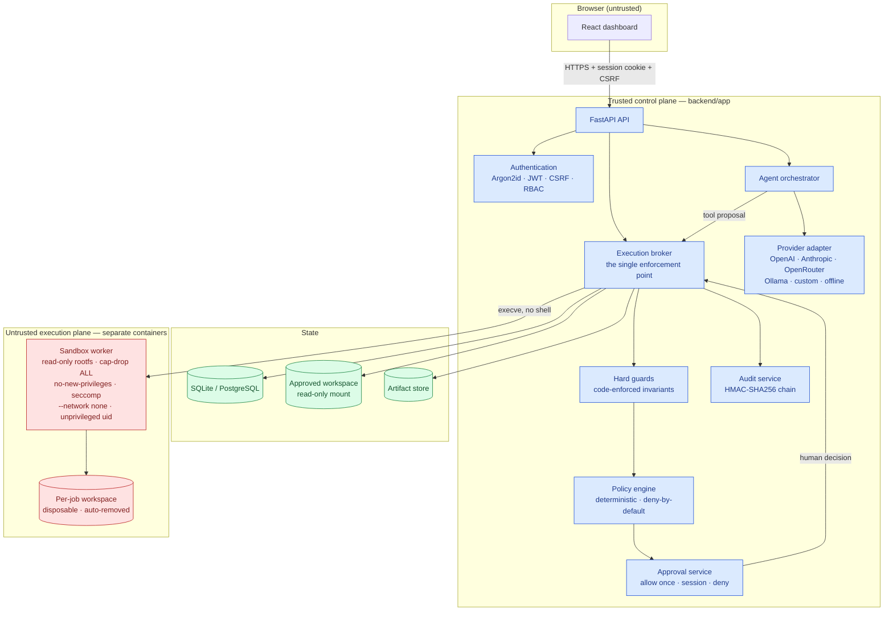
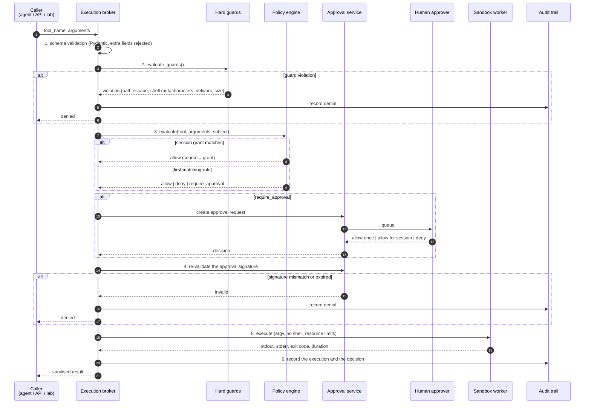
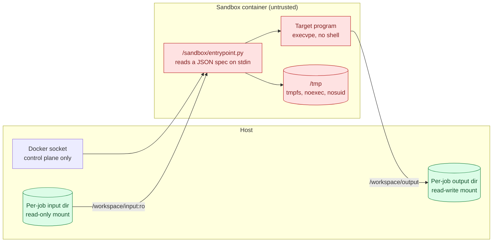
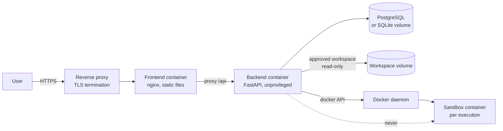

# Architecture

## Design principle

> **LLMs propose actions. The server decides permissions. The kernel enforces
> isolation.**

The system is split into a *trusted control plane* and an *untrusted execution
plane*. Everything that can grant a capability lives in the control plane.
Everything that runs attacker-influenced code lives in the execution plane and
can never reach back.



## Trust boundaries

| # | Boundary | What crosses it | What must never cross it |
| - | -------- | --------------- | ------------------------- |
| 1 | Browser ↔ control plane | Session cookie, CSRF token, tool arguments, model output | The browser never grants a permission; the API never trusts a client-side decision |
| 2 | Control plane ↔ model | System prompt, sanitised tool results | The model never sends a permission; tool output is always tagged untrusted |
| 3 | Control plane ↔ policy engine | Canonical tool name and arguments | The model cannot influence the policy document, the rule order or the guard set |
| 4 | Control plane ↔ execution plane | `argv`, a JSON specification on stdin, two bind mounts | The worker never receives credentials, the Docker socket, the database or the policy |
| 5 | Control plane ↔ host filesystem | Reads inside the approved workspace, writes into the artifact store | Nothing outside the workspace is readable; nothing is written to the workspace by an agent |
| 6 | Control plane ↔ database | Session, execution, approval and audit rows | The model never talks to the database |

## The enforcement pipeline

Every tool call — from the dashboard, the agent loop, the attack laboratory or
a script — passes through `ToolBroker.execute` in
`backend/app/services/broker.py`. The order is fixed and cannot be skipped.



## Components

### `backend/app/policy/`

* `schema.py` — the strict Pydantic schema of a policy document. Unknown
  fields are rejected, duplicate rule ids are rejected, effects are limited to
  `allow`, `deny` and `require_approval`.
* `engine.py` — the deterministic evaluator. Rules are ordered by descending
  `priority` and then ascending `id`; the first matching rule decides. Path
  constraints are matched against the **requested** path *and* the **resolved**
  path, so a symbolic link cannot launder a protected path.
* `guards.py` — the hard guards. These are code, not configuration, and always
  run first.

### `backend/app/core/`

* `paths.py` — `SafePathResolver`: normalisation, realpath containment,
  `O_NOFOLLOW` reads, hard-link refusal and atomic writes.
* `commands.py` — the command allowlist. Commands are validated as an `argv`
  vector; shell metacharacters, absolute program paths, path separators and
  dangerous flags are rejected.
* `security.py` — Argon2id hashing, JWT creation and verification, CSRF
  tokens, constant-time comparison.
* `redaction.py` — the credential scrubber used by the logger, the audit
  trail, the API responses and the sandbox environment.
* `container.py` — the application container that wires everything together.

### `backend/app/sandbox/`

* `base.py` — the `SandboxBackend` interface, the request and result types
  and the `SandboxUnavailableError`.
* `docker_backend.py` — the hardened container backend.
* `local_backend.py` — the explicitly labelled, **non-isolating** simulation
  backend for offline development.

### `backend/app/providers/`

* `base.py` — the provider interface, the internal message format and the
  usage accounting.
* `openai_compat.py` — OpenAI, OpenRouter, Ollama and any custom
  OpenAI-compatible endpoint, including a prompt-based tool calling fallback.
* `anthropic.py` — the Anthropic Messages API with native tool use.
* `simulation.py` — the deterministic offline planner.
* `registry.py` — the factory, the price table and the budget guard.

### `backend/app/orchestrator/`

* `agent.py` — the agent loop.
* `prompts.py` — the system prompt. The prompt is **not** a security control;
  it only tells the model how to behave.

### `backend/app/services/`

* `broker.py` — the single enforcement point.
* `approvals.py` — the approval workflow and session grants.
* `audit.py` — the append-only audit trail with the integrity chain.
* `workspace.py` — the workspace helpers and the artifact store.
* `attack_lab.py` — the prompt-injection laboratory.
* `secrets.py` — the encryption of provider credentials at rest.

## The sandbox container



The entry point receives a JSON specification on stdin:

```json
{
  "argv": ["python3", "-I", "-B", "/workspace/input/script.py"],
  "cwd": "/workspace/input",
  "timeout": 30,
  "env": {}
}
```

It applies `setrlimit` limits, drops supplementary groups, installs a wall
clock alarm and then calls `os.execvpe`. There is no shell, no command
substitution and no glob expansion anywhere in the execution path.

## Data flow of a tool result

1. The tool handler returns a `ToolResult` with a JSON-serialisable payload.
2. The broker serialises it, truncates it to the configured output limit and
   stores it in the execution row.
3. The agent loop renders it for the model, marks the message as
   `is_untrusted` and includes the policy decision, so the model can see that
   an action was denied instead of silently getting an empty result.
4. The audit trail stores the **redacted** arguments and a short summary. The
   full output stays in the execution row.

## Deployment topology



The backend container is the only component that can talk to the Docker
daemon. Sandbox containers are started by the broker with no access to it.
